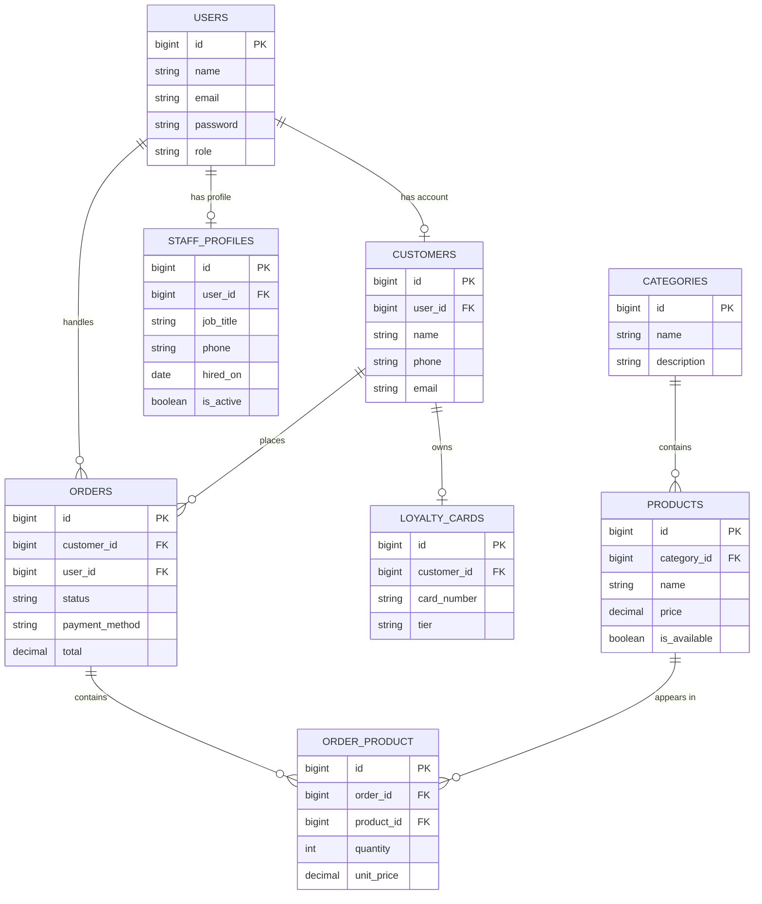
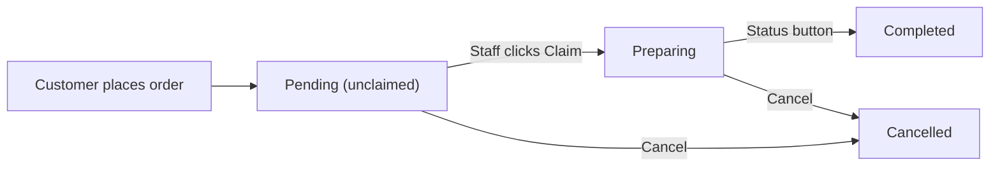

<div align="center">

# 📘 Dalxiis Coffee Shop: Project Guideline

**Everything you need to install, run, understand and extend the project.**

[← Back to the project page](README.md)

</div>

---

## 📑 Contents

- [Roles and permissions](#-roles-and-permissions)
- [Tech stack](#-tech-stack)
- [Database design](#-database-design)
- [Order lifecycle](#-order-lifecycle)
- [Getting started (installation)](#-getting-started)
- [Demo accounts](#-demo-accounts)
- [Project structure](#-project-structure)
- [Security highlights](#-security-highlights)
- [Useful commands](#-useful-commands)
- [Troubleshooting](#-troubleshooting)
- [How to read the code](#-how-to-read-the-code)

---

## 🔐 Roles and permissions

| Capability | Customer | Employee | Manager | Admin |
|---|:---:|:---:|:---:|:---:|
| Browse and search the menu | ✅ | ✅ | ✅ | ✅ |
| Cart and place orders | ✅ | ❌ | ❌ | ❌ |
| See own orders only | ✅ | | | |
| See orders | | Own + unclaimed | All | All |
| Claim orders, change status | | Own orders | All | All |
| Delete orders | ❌ | ❌ | ✅ | ✅ |
| Products, categories, customers | ❌ | ❌ | ✅ | ✅ |
| Team: manage employees | ❌ | ❌ | ✅ | ✅ |
| Team: manage managers | ❌ | ❌ | ❌ | ✅ |
| Users page (all accounts) | ❌ | ❌ | ❌ | ✅ |

Permissions are enforced in **three layers**: route middleware, ownership checks inside controllers, and hidden buttons in the views.

---

## 🧰 Tech stack

| Layer | Technology |
|---|---|
| Framework | Laravel 13 (PHP) |
| Database | MySQL 8 |
| Templates | Blade |
| Styling | Bootstrap 5 (CDN) |
| Environment | Docker with Laravel Sail |
| Authentication | Laravel session auth with a custom `RoleMiddleware` |
| ORM | Eloquent |

---

## 🗄️ Database design

8 project tables created with migrations, connected with one-to-one, one-to-many and many-to-many relationships.



| Relationship | Type |
|---|---|
| Customer ↔ LoyaltyCard | One-to-one |
| User ↔ StaffProfile | One-to-one |
| User ↔ Customer | One-to-one |
| Category → Products | One-to-many |
| Customer → Orders | One-to-many |
| User (staff) → Orders | One-to-many |
| Orders ↔ Products | **Many-to-many** (pivot `order_product` with `quantity` and `unit_price`) |

**Design decisions worth knowing**
- `unit_price` is stored in the pivot so **old orders keep the price the customer paid**.
- An order with an empty `user_id` means **unclaimed**; the Claim button assigns it.
- Delete rules protect history: categories with products and products in past orders cannot be deleted.
- Loyalty points are **computed** from completed orders, so they can never get out of sync.

---

## 🔄 Order lifecycle



---

## 🚀 Getting started

### Prerequisites

- [Docker](https://docs.docker.com/get-docker/) (Docker Compose included)
- [Composer](https://getcomposer.org/)
- Git

No Node or npm build step is needed: Bootstrap is loaded from a CDN.

### Installation

**1. Clone the repository**

```bash
git clone https://github.com/YOUR-USERNAME/dalxiis-coffee-shop.git
cd dalxiis-coffee-shop
```

**2. Create the environment file**

```bash
cp .env.example .env
```

**3. Set the database in `.env`** (these values match the Sail MySQL container)

```env
DB_CONNECTION=mysql
DB_HOST=mysql
DB_PORT=3306
DB_DATABASE=laravel
DB_USERNAME=sail
DB_PASSWORD=password
```

**4. Install PHP dependencies and start the containers**

```bash
composer install
./vendor/bin/sail up -d
```

Wait until MySQL is `healthy` (check with `./vendor/bin/sail ps`).

**5. Generate the app key, then build the database with demo data**

```bash
./vendor/bin/sail artisan key:generate
./vendor/bin/sail artisan migrate:fresh --seed
```

**6. Open the app**

👉 **http://localhost**

> **Port 3306 already in use?** Add `FORWARD_DB_PORT=3307` to `.env`, then run `./vendor/bin/sail down` and `./vendor/bin/sail up -d`. Keep `DB_PORT=3306`.

---

## 🔑 Demo accounts

The password for every account is **`password`**.

| Role | Email | What to try |
|---|---|---|
| 🛡️ Admin | `admin@dalxiis.test` | Team (add a manager), Users, full dashboard |
| 🧑‍💼 Manager | `manager@dalxiis.test` | Products, categories, customers, Team (add an employee) |
| 👨‍🍳 Employee | `ahmed@dalxiis.test` | Claim a waiting order, change its status |
| 👨‍🍳 Employee | `ayaan@dalxiis.test` | Same, with their own order list |
| 🛒 Customer | `amina.ali@example.com` | Search the menu, fill the cart, place an order |

> These accounts are for demonstration only. Remove or change them before any real deployment.

---

## 🗂️ Project structure

```text
dalxiis-coffee-shop/
├── app/
│   ├── Http/
│   │   ├── Controllers/
│   │   │   ├── Auth/              Login, Register
│   │   │   ├── CartController.php
│   │   │   ├── CategoryController.php
│   │   │   ├── CustomerController.php
│   │   │   ├── DashboardController.php
│   │   │   ├── HomeController.php
│   │   │   ├── MyOrderController.php
│   │   │   ├── OrderController.php
│   │   │   ├── ProductController.php
│   │   │   ├── TeamController.php
│   │   │   └── UserController.php
│   │   └── Middleware/
│   │       └── RoleMiddleware.php
│   └── Models/                    User, Category, Product, Customer,
│                                  LoyaltyCard, Order, StaffProfile
├── docs/images/                   logo, banner and design images
├── database/
│   ├── migrations/                8 project tables
│   └── seeders/DatabaseSeeder.php demo staff, customers, products, orders
├── resources/views/
│   ├── layouts/app.blade.php      shared layout and role-based navbar
│   ├── partials/                  alerts, search box
│   └── auth, cart, categories, customers, my-orders,
│       orders, products, team, users
└── routes/web.php                 all routes, grouped by role
```

**Every feature follows the same chain:** route → controller → model → view.

---

## 🛡️ Security highlights

| Threat | Defense |
|---|---|
| CSRF | `@csrf` token in every form |
| XSS | Blade `{{ }}` escapes all output |
| SQL injection | Eloquent uses bound parameters |
| Mass assignment | `$fillable` on every model, validated data only |
| Weak passwords | Hashed storage, minimum 8 characters, confirmation |
| Privilege escalation | The role is never read from a public form; only managers and admins create staff |
| Seeing other people's data | Ownership checks for customers and employees |
| Session fixation | Session id regenerated after login |

---

## 🧪 Useful commands

```bash
./vendor/bin/sail up -d                     # start the containers
./vendor/bin/sail down                      # stop them
./vendor/bin/sail artisan migrate:fresh --seed   # rebuild DB with demo data
./vendor/bin/sail artisan route:list        # list every route
./vendor/bin/sail artisan tinker            # play with the models
./vendor/bin/sail artisan optimize:clear    # clear route, view and config caches
```

---

## 🩺 Troubleshooting

| Problem | Cause | Fix |
|---|---|---|
| `Unknown column 'role'` | The newest migrations have not run | `./vendor/bin/sail artisan migrate:fresh --seed` |
| `Connection refused` on migrate | MySQL is still starting | Wait until `./vendor/bin/sail ps` shows `healthy`, then retry |
| Port 3306 already in use | A system MySQL is running | Add `FORWARD_DB_PORT=3307` to `.env`, then `sail down` and `sail up -d` (keep `DB_PORT=3306`) |
| `419 Page Expired` | A form is missing `@csrf` or the session expired | Reload the page and submit again |
| `403 Forbidden` | The logged-in role is not allowed on that page | Log in with the right role (see demo accounts) |
| Route or view changes do not show | Cached routes or views | `./vendor/bin/sail artisan optimize:clear` |

---

## 🧭 How to read the code

Every feature follows the same chain, so start at the route and follow it:

```text
route (routes/web.php)  ->  controller  ->  model (Eloquent)  ->  view (Blade)
```

1. **Pick a page** in the app, for example *Orders*.
2. **Find its route** in `routes/web.php` (`orders.index`).
3. **Open the controller** method it calls (`OrderController@index`).
4. **See the model** it queries (`Order`) and the relationships it loads.
5. **Open the view** it returns (`resources/views/orders/index.blade.php`).

Good files to read first: `routes/web.php`, `RoleMiddleware.php`, `OrderController.php`, `CartController.php` and `app/Models/User.php`.

---

<div align="center">

[← Back to the project page](README.md)

</div>