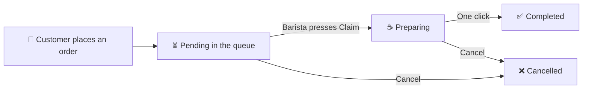

# Dalxiis-coffee-shop

### From cart to cup: one system for customers, baristas, managers and owners.

[**Features**](#-what-you-get) · [**Roles**](#-built-for-every-person-in-the-shop) · [**How it works**](#-from-cart-to-cup) · [**Design**](#-the-design) · [**Guideline**](GUIDELINE.md)

---

## ☕ The idea

A coffee shop moves fast. Orders arrive from walk-ins and from online customers, a rotating team prepares them, and the manager needs to know what is happening right now.

Without a system, orders get lost, two baristas make the same drink, and nobody knows who did what.

**Dalxiis Coffee Shop puts every order, every person and every product in one place, and gives each person exactly the access they need.**

| **4** | **8** | **3** | **0** |
|:---:|:---:|:---:|:---:|
| user roles | database tables | relationship types | lines of custom JavaScript |

---

## ✨ What you get

<table>
<tr>
<td width="50%" valign="top">

### 🛒 Order online in seconds
Customers search the menu, filter by category, fill a cart and place an order. No phone call, no waiting in line.

</td>
<td width="50%" valign="top">

### 🙋 No more double work
Online orders land in a shared queue. A barista presses **Claim**, and that order is theirs. Nobody makes the same drink twice.

</td>
</tr>
<tr>
<td valign="top">

### 🔄 One-click status
Pending, Preparing, Completed, Cancelled: a single button changes it, and the customer sees the update in their own order page.

</td>
<td valign="top">

### 🔐 The right access for everyone
Four roles, three layers of protection. A barista sees only their own orders. A customer sees only theirs. Managers and the admin see more.

</td>
</tr>
<tr>
<td valign="top">

### 💳 Loyalty cards built in
Every customer gets a loyalty card with a tier and points that grow with each completed order.

</td>
<td valign="top">

### 🔍 Search everywhere
Every list page has a search box: orders by number or customer, products by name or category, staff by role or job title.

</td>
</tr>
<tr>
<td valign="top">

### 👥 Team management
Managers add and update employees. The admin adds and updates managers too. Staff can be switched to inactive, and they can no longer log in.

</td>
<td valign="top">

### 📊 A dashboard that tells the truth
Sales today, completed revenue, open orders, the claim queue and best sellers, all in one screen. Employees see only their own numbers.

</td>
</tr>
</table>

---

## 👥 Built for every person in the shop

<table>
<tr>
<td width="25%" valign="top">

### 🛒 Customer
- Browse and search the menu
- Cart and checkout
- Follow every order
- Loyalty card and points
- Cancel a pending order

</td>
<td width="25%" valign="top">

### 👨‍🍳 Employee
- Personal dashboard
- Claim waiting orders
- One-click status buttons
- Create walk-in orders

</td>
<td width="25%" valign="top">

### 🧑‍💼 Manager
- Everything an employee does
- Manage products and categories
- Manage customers
- Add and update employees

</td>
<td width="25%" valign="top">

### 🛡️ Admin
- Everything a manager does
- Add and update managers
- Manage every user account
- Full view of the shop

</td>
</tr>
</table>

---

## 🔄 From cart to cup

1. **Order:** the customer picks items and checks out.
2. **Queue:** the order waits, unclaimed, on every staff dashboard.
3. **Claim:** one barista takes it. It moves to *Preparing*.
4. **Done:** one click marks it *Completed*, and the customer's points go up.

---

## 🎨 The design

A warm coffee palette (espresso brown, caramel accent, cream background), one clean layout, and a navbar that changes with who is logged in.

  

<table>
<tr>
<td width="33%"> <b>Customer menu</b>: search, categories, add to cart</td>
<td width="33%"> <b>Admin dashboard</b>: sales, claim queue, best sellers</td>
<td width="33%"> <b>Employee order page</b>: one-click status</td>
</tr>
</table>

---

## 🧰 Built with

**Why this stack?** Laravel gives clean MVC and Eloquent relationships, Blade keeps every page server-rendered and simple, and Bootstrap makes it responsive. The result is a fast, readable project that needs **no custom JavaScript**.

---

## 🛠️ Under the hood

- **Smart data model:** eight tables with one-to-one, one-to-many and many-to-many relationships.
- **Fair prices, forever:** each order line stores its own unit price, so old orders never change when the menu does.
- **Safe by design:** protection against CSRF, XSS, SQL injection and mass assignment, hashed passwords, and role checks in the routes, the controllers and the views.
- **All or nothing:** orders are saved in database transactions, so there is never a half-saved order.
- **Protected history:** products that appear in past orders cannot be deleted by accident.

---

## 🗺️ Roadmap

- [x] Four roles with layered access control
- [x] Online cart, checkout and order tracking
- [x] Claim queue and one-click status
- [x] Team management and staff profiles
- [x] Search on every list page
- [ ] Automated tests
- [ ] Password reset by email
- [ ] Online payments
- [ ] Live search with a JSON API

---

## 📘 Want to run it or learn from it?

Installation, demo accounts, database diagram, project structure and troubleshooting are all in the **[Project Guideline →](GUIDELINE.md)**.

---

**Built by Zaki** · Final project for Advanced Web Development

Made with ☕ and Laravel

